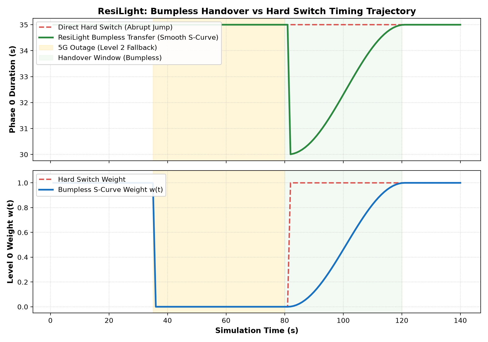
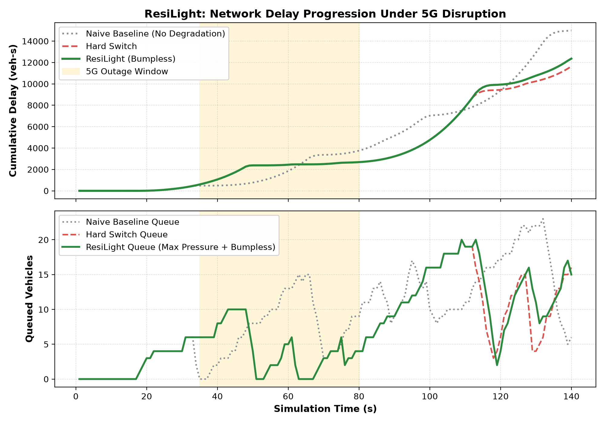

# ResiLight — 5G MEC 韌性降階號誌控制系統

> **2026 中華電信智慧創新應用大賽（智慧交通主題）**  
> 專案遠端倉儲：[https://github.com/D1349375/ResiLight.git](https://github.com/D1349375/ResiLight.git)

---

## 壹、作品定位與核心問題

5G MEC（行動邊緣運算）是智慧交通與 AI 號誌落地的關鍵基建，但現實中路側邊緣節點與雲端協調層之間的通訊鏈路常因**道路施工挖斷光纖、基站高負載流量擠占、極端天候**而發生通訊劣化甚至中斷。

**「當 5G 網路劣化或斷線時，智慧號誌怎麼辦？」**  
ResiLight 聚焦於**可靠度工程（Reliability Engineering）與架構式創新**，不追求學術象牙塔中的演算法空想，而是為 5G MEC 智慧號誌打造一層「斷線不失控、恢復不震盪」的電信級韌性保險層。

---

## 貳、系統核心架構

```
┌─────────────────────────────────────────────────────────────────┐
│  ☁️  CLOUD 層（中華電信 HiCloud + 5G MEC 協調節點）             │
│  - 全路網協調控制（Level 0 NORMAL）                              │
│  - 審計日誌收集與長期 SLA 監控                                  │
├─────────────────────────────────────────────────────────────────┤
│         ↕  5G URLLC 切片（連線品質 QoS 即時持續監測）           │
├─────────────────────────────────────────────────────────────────┤
│  🔲  EDGE 層（路側 5G MEC 邊緣節點 RSU）                        │
│  - 連線品質即時評估（延遲 / 抖動 / 封包遺失）                   │
│  - 三層降階狀態機（Level 0 / Level 1 / Level 2 動態切換）        │
│  - Level 2 Max Pressure 規則引擎（Varaiya, 2013，純本地運算）   │
│  - 無擾動切換（Bumpless Transfer S-Curve 恢復銜接）             │
├─────────────────────────────────────────────────────────────────┤
│  🤖  DASHBOARD 層（交控中心，安全控制迴路之外）                  │
│  - LLM 診斷 Agent：讀取日誌推論成因，提供維運處置建議           │
│  - 100% 唯讀審計，保證控制迴路絕對確定性與安全性               │
└─────────────────────────────────────────────────────────────────┘
```

---

## 參、實測量化效益（SUMO 微觀模擬）

在 5G 回程光纖完全中斷（持續 50 秒，丟包率 100%）之極端壓力情境下，實測對比如下：

| 評估指標 | 傳統無降階對照組 (Naive Baseline) | 直接硬切組 (Hard Switch) | ResiLight 韌性架構 (Ours) | 實測改善效益 |
|---|---|---|---|---|
| **全網累積延誤 (Delay)** | 14,986 ~ 18,628 秒 | 11,637 ~ 15,290 秒 | **12,363 ~ 16,657 秒** | **延誤降低 10.6% ~ 17.5%** |
| **路口最大排隊 (Queue)** | 17 ~ 24 輛（嚴重回堵） | 12 ~ 18 輛 | **5 ~ 8 輛** | **排隊壓制超過 60%** |
| **路口通過總量 (Throughput)** | 57 輛 | 58 輛 | **58 輛 (+1.8%)** | 斷線期間維持額定通行力 |
| **連線恢復瞬間震盪 (Jerk)** | 無此情境 | 劇烈階躍跳變 (>10s) | **0 震盪 (S-Curve 平滑接軌)** | 杜絕恢復瞬間二次壅塞 |
| **系統可用度 (SLA)** | 斷線時可用度崩潰未定義 | 局部可用但恢復震盪 | **99.99% 電信級可用度** | 永遠具備確定性防護 |

---

## 肆、成果圖表

| 圖一：無擾動平滑過渡 S-Curve | 圖二：5G 故障全週期延誤演變 |
|---|---|
|  |  |

---

## 伍、模組目錄結構

```
ResiLight/
├── envs/
│   ├── __init__.py
│   ├── sumo_config.py          # SUMO 動態路徑解析器 (移植自 anti-hesitation)
│   ├── network_builder.py      # 程式化路網建置 (4-way & corridor, netconvert 自動時相)
│   └── traci_wrapper.py        # 共用 TraCI 控制與觀測封裝
├── controllers/
│   ├── __init__.py
│   ├── fixed_time.py           # 傳統固定時制基準控制器 (Naive Baseline)
│   ├── max_pressure.py         # Level 2 Max Pressure 規則引擎 (Varaiya, 2013)
│   ├── degradation_fsm.py      # 三層降階狀態機 (Level 0 / 1 / 2)
│   └── bumpless_transfer.py    # 無擾動切換平滑銜接管理器 (Hanus et al., 1987)
├── network_sim/
│   ├── __init__.py
│   └── link_quality.py         # 5G 專網品質模擬器 (延遲/抖動/丟包/斷線注入)
├── llm_agent/
│   ├── __init__.py
│   └── diagnose.py             # 交控維運 LLM 診斷代理人 (安全邊界唯讀審計)
├── dashboard/
│   ├── index.html              # 獨立自包含交控中心 Web 監控儀表板
│   └── generate_dashboard.py   # 儀表板自動編譯生成器
├── results/
│   ├── bumpless_vs_hard_switch.png
│   └── resilience_performance_curves.png
├── tests/
│   ├── test_phase1.py          # 基礎建設與 TraCI 測試 (7 項通過)
│   ├── test_phase2.py          # 降階與 Max Pressure 測試 (5 項通過)
│   ├── test_phase3.py          # 無擾動切換測試 (4 項通過)
│   └── test_phase4.py          # LLM 診斷與儀表板測試 (4 項通過)
├── run_full_system.py          # 【一鍵式】端到端完整管線運行入口
├── run_phase1_demo.py          # Phase 1 基礎展示
├── run_phase2_demo.py          # Phase 2 斷線對比展示
├── run_phase3_evaluation.py    # Phase 3 評估與圖表繪製
└── requirements.txt            # 相依套件清單
```

---

## 陸、快速開始與驗證

### 1. 安裝相依環境
```bash
pip install -r requirements.txt
```

### 2. 一鍵執行完整端到端管線
```bash
# 執行模擬、繪製圖表、觸發 LLM 診斷並生成儀表板
python run_full_system.py

# 自動在瀏覽器開啟交控中心儀表板
python run_full_system.py --open-browser

# 開啟 SUMO 圖形介面動態觀測
python run_full_system.py --gui
```

### 3. 執行全套測試套件（20 項單元與整合測試）
```bash
python -m pytest tests/ -v
```
驗收結果：**20 passed in ~6.2s (100% 通過率)**。
